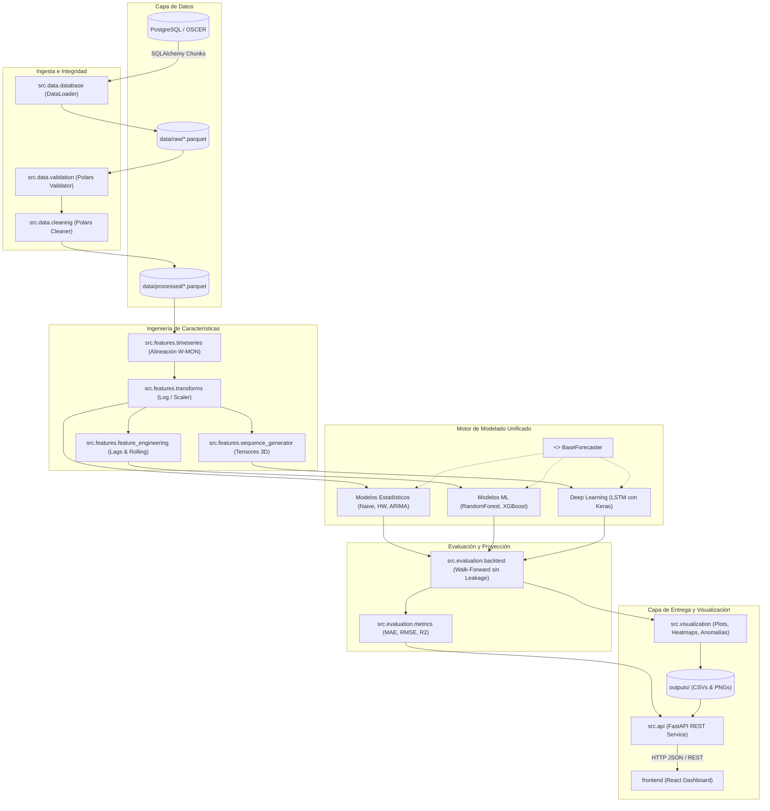

# Auditoría Técnica y Propuesta de Rediseño Arquitectónico del Repositorio de Modelos de Predicción Epidemiológica

**Proyecto:** UNSA & University of Oklahoma — Team B (Salud y Sociedad)  
**Dominio:** Modelado Predictivo de Hospitalizaciones y Defunciones por Neumonía e Infecciones Respiratorias Agudas (IRAS)  
**Fecha de Auditoría:** Noviembre 2026  
**Rol del Auditor:** Senior Software Engineer & Lead ML System Architect  
**Estado:** Diagnóstico Exhaustivo y Diseño de Arquitectura Futura (Sin ejecución de código destructivo)

---

## 1. Resumen Ejecutivo

El presente documento constituye una auditoría técnica y arquitectónica formal del repositorio `Pneumonias`. El sistema tiene como objetivo el modelado, validación y predicción temporal de series epidemiológicas (hospitalizaciones y defunciones de menores de 5 años y adultos mayores de 60 años) en los 25 departamentos del Perú, empleando modelos estadísticos basales (Naive, Seasonal Naive, Holt-Winters, ARIMA), modelos de Machine Learning (Random Forest, XGBoost) y modelos de Deep Learning (LSTM bidireccionales/recurrentes con Keras/TensorFlow).

### Hallazgos Críticos Principales

1. **Duplicación Masiva de Código (~85% de redundancia en `src/models/`):**  
   El directorio `src/models/` contiene 12 scripts monolíticos que totalizan **11,876 líneas de código**. Mediante análisis de diferencias estructurales (`diff`), se ha verificado que estos 12 archivos son clones casi exactos agrupados en 3 familias de 4 scripts cada una (correspondientes a los 4 targets: `adults_death`, `adults_hosp`, `children_death`, `children_hosp`). Dentro de cada familia, **más del 98% de las líneas son idénticas carácter por carácter**, difiriendo únicamente en 16 líneas de configuración textual (nombres de columnas y rutas de salida).
2. **Desconexión Total del Pipeline de Datos e Integridad:**  
   Existe un módulo avanzado de validación y limpieza basado en Polars (`src/integrity/` y `src/outliers/`) diseñado para generar datos depurados en `data/processed/`. Sin embargo, el directorio `data/processed/` **no existe**, y todos los 12 scripts de modelos leen directamente un archivo temporal no versionado ni procesado: `data/raw/iras_data_raw_temp.parquet`.
3. **Data Leakage y Falla Metodológica en el Backtesting de Machine Learning:**  
   En los scripts `*_ml_final.py`, la ingeniería de características (`create_features`) genera rezagos (`lag_1`, `lag_2`, etc.) y medias móviles sobre el conjunto completo de datos antes de la división de ventanas. Durante el backtesting de horizonte multi-paso ($H=4$), el modelo consulta los rezagos reales observados de las semanas $t+1, t+2, t+3$ (mecanismo conocido como *Teacher Forcing* o lookahead leakage). En contraste, la proyección futura (`forecast_future`) opera mediante predicción recursiva autorregresiva. Esto genera una brecha metodológica: **las métricas de evaluación reportadas (MAE, RMSE, $R^2$) son artificialmente optimistas y no reflejan el error real de predicción**. Asimismo, el percentil 99 de truncamiento de outliers se calcula sobre toda la serie temporal (2006–2023), filtrando información futura al pasado.
4. **Fuga Crítica de Memoria e Ineficiencia Computacional en Deep Learning (LSTM):**  
   Los scripts `*_lstm_final.py` re-instancian y entrenan una red neuronal Keras desde cero en cada paso de la ventana deslizante ($169 \text{ ventanas} \times 25 \text{ regiones} = 4,225 \text{ redes neuronales}$ por script), sin invocar `tf.keras.backend.clear_session()`. Esto provoca una acumulación continua de grafos en memoria y tiempos de ejecución prohibitivos, lo cual explica por qué los modelos para niños (`children_death_lstm_optimized` y `children_hosp_lstm_optimized`) **nunca llegaron a generarse en `outputs/`**.
5. **Inconsistencias Severas en el Entorno y Dependencias:**  
   El archivo `requirements.txt` se encuentra guardado en codificación binaria **UTF-16LE con BOM** (incompatible con múltiples herramientas POSIX/Linux y CI/CD), contiene dependencias duplicadas/conflictivas (`dotenv==0.9.9` y `python-dotenv==1.2.2`), y **omite por completo `tensorflow`**, a pesar de ser requerido obligatoriamente por 4 scripts de Deep Learning.
6. **Desconexión Arquitectónica con el Frontend:**  
   El repositorio aloja una interfaz moderna en React/Vite/TypeScript (`frontend/`) que espera consumir un API REST (`http://localhost:8000/api/...`), pero el backend carece de una capa de servicio (FastAPI/Flask) y opera exclusivamente mediante la persistencia de cientos de archivos CSV y PNG planos.

### Conclusión y Dictamen
Se dictamina una **Refactorización Progresiva (Patrón Strangler Fig)** estructurada en 5 etapas. Mantener la arquitectura actual representa un riesgo severo de deuda técnica, deriva de datos y costos de mantenimiento prohibitivos. El rediseño propuesto reducirá la base de código de ~12,000 líneas a menos de 2,200 líneas modulares y testeadas, garantizando reproducibilidad científica, prevención de fugas de datos y desacoplamiento con la interfaz de usuario.

---

## 2. Descripción General del Repositorio

El proyecto `Pneumonias` aborda la modelización y vigilancia epidemiológica orientada a la toma de decisiones sanitarias. Su alcance técnico comprende:

* **Ingesta de Datos:** Descarga por lotes desde una base de datos relacional PostgreSQL / OSCER hacia archivos locales en formato Apache Parquet.
* **Integridad y Depuración:** Detección de silencios de reporte epidemiológico, duplicados por sub-ubigeos, inconsistencias lógicas (hospitalizaciones mayores a casos reportados, decesos sin hospitalización previa) y valores atípicos multivariados.
* **Modelado Predictivo:** Proyecciones de series de tiempo a 4 semanas vista con ventana de entrenamiento de 5 años (260 semanas) y paso de 4 semanas, aplicadas de manera independiente sobre 25 regiones sanitarias peruanas.
* **Presentación:** Generación de gráficos estáticos de predicción, heatmaps anual-semanales, matrices de anomalías epidemiológicas basadas en Z-Score, y un prototipo de frontend en React.

---

## 3. Estructura Actual del Repositorio

### 3.1. Árbol de Directorios Comentado

```text
Pneumonias/
│
├── .env                                  # Variables de entorno locales (credenciales DB)
├── .env.example                          # Plantilla de variables de entorno
├── .gitignore                            # Exclusiones de Git
├── README.md                             # Documentación introductoria general
├── requirements.txt                      # Dependencias Python (codificado en UTF-16LE, omite TF)
│
├── data/
│   ├── raw/                              # Datos crudos extraídos de OSCER / BD
│   │   ├── iras_data_raw.parquet         # Dataset primario de IRAs (esquema en inglés)
│   │   ├── iras_data_raw_temp.parquet    # Dataset temporal consumido por los modelos (esquema en español)
│   │   ├── iras_weekly_dept.parquet      # Serie agregada departamental de IRAs
│   │   ├── iras_weekly_prov.parquet      # Serie agregada provincial de IRAs
│   │   ├── pneumonia_weekly_incidence_dept.parquet # Incidencia de neumonía departamental
│   │   ├── pneumonia_weekly_incidence_prov.parquet # Incidencia de neumonía provincial
│   │   ├── population_annual_dept.parquet          # Población anual departamental
│   │   ├── population_annual_prov.parquet          # Población anual provincial
│   │   ├── population_dept_long.parquet            # Población departamental en formato largo
│   │   ├── population_prov_long.parquet            # Población provincial en formato largo
│   │   └── population_raw_dist.parquet             # Población distrital cruda
│   └── processed/                        # [INEXISTENTE] Destino previsto por cleaning.py pero nunca creado
│
├── notebooks/
│   └── .gitkeep                          # Directorio vacío de notebooks exploratorios
│
├── outputs/                              # Salidas generadas por la ejecución de scripts
│   ├── adults_death_baseline_stat_optimized/   # CSVs y PNGs de modelos estadísticos (Adultos / Decesos)
│   ├── adults_death_lstm_optimized/            # CSVs y PNGs de modelos LSTM (Adultos / Decesos)
│   ├── adults_death_ml_optimized/              # CSVs y PNGs de Random Forest y XGBoost (Adultos / Decesos)
│   ├── adults_hosp_baseline_stat_optimized/    # CSVs y PNGs de modelos estadísticos (Adultos / Hosp)
│   ├── adults_hosp_lstm_optimized/             # CSVs y PNGs de modelos LSTM (Adultos / Hosp)
│   ├── adults_hosp_ml_optimized/               # CSVs y PNGs de modelos ML (Adultos / Hosp)
│   ├── children_death_baseline_stat_optimized/ # CSVs y PNGs estadísticos (Niños / Decesos)
│   ├── children_death_ml_optimized/            # CSVs y PNGs de modelos ML (Niños / Decesos)
│   ├── children_hosp_baseline_stat_optimized/  # CSVs y PNGs estadísticos (Niños / Hosp)
│   ├── children_hosp_ml_optimized/             # CSVs y PNGs de modelos ML (Niños / Hosp)
│   │   # NOTA: children_death_lstm_optimized y children_hosp_lstm_optimized no existen (ejecución abortada/incompleta)
│   └── hosp_deaths_analysis/                   # Salidas de análisis descriptivo de letalidad y rezagos
│
├── reports/
│   ├── figures/                          # .gitkeep
│   ├── integrity/                        # Reportes y gráficos generados por src/integrity/validation.py
│   │   ├── figures/                      # Gráficos de barras y heatmaps de nulos/inconsistencias
│   │   ├── cleaning_report.txt           # Registro de recomendaciones R1 a R4
│   │   ├── integrity_overview.csv        # Matriz consolidada de calidad por tabla
│   │   ├── silence_by_province.csv       # Análisis de semanas con silencio epidemiológico
│   │   └── ...                           # Ficheros detallados de brechas e incidencias
│   └── outliers/                         # Reportes y gráficos generados por src/outliers/detection.py
│       ├── figures/                      # Visualizaciones de anomalías por departamento
│       ├── outliers_report.txt           # Resumen de detección multivariada
│       └── ...                           # CSVs y Parquets con clasificaciones IQR, MAD, Rolling, Seasonal e IForest
│
├── src/                                  # Código fuente principal en Python (Carece de __init__.py raíz)
│   ├── config.py                         # Clase Config con parámetros DB (ignorada por los modelos)
│   ├── data_loader.py                    # Descarga por lotes desde PostgreSQL usando SQLAlchemy
│   ├── analysis/                         # Análisis exploratorio de datos
│   │   └── hosp_deaths_analysis.py       # Script monolítico de 930 líneas para letalidad y cross-correlación
│   ├── integrity/                        # Módulo de calidad de datos (basado en Polars)
│   │   ├── __init__.py                   # Docstring del paquete
│   │   ├── README.md                     # Documentación de reglas de limpieza
│   │   ├── validation.py                 # Validador de esquemas, rangos y coherencia epidemiológica (437 líneas)
│   │   └── cleaning.py                   # Deduplicación y corrección de casos/hospitalizaciones (332 líneas)
│   ├── outliers/                         # Módulo de detección de anomalías (basado en Polars y Scikit-Learn)
│   │   ├── __init__.py                   # Docstring del paquete
│   │   ├── README.md                     # Metodología de detección (5 métodos)
│   │   └── detection.py                  # Detección IQR, MAD, Rolling-Z, Seasonal e Isolation Forest (394 líneas)
│   └── models/                           # 12 Scripts de entrenamiento y proyección (11,876 líneas)
│       ├── adults_death_baseline_stats_final.py    # 913 líneas
│       ├── adults_death_lstm_final.py              # 962 líneas
│       ├── adults_death_ml_final.py                # 1038 líneas
│       ├── adults_hosp_baseline_stats_final.py     # 913 líneas
│       ├── adults_hosp_lstm_final.py               # 967 líneas
│       ├── adults_hosp_ml_final.py                 # 1147 líneas
│       ├── children_death_baseline_stats_final.py  # 913 líneas
│       ├── children_death_lstm_final.py            # 962 líneas
│       ├── children_death_ml_final.py              # 1038 líneas
│       ├── children_hosp_baseline_stats_final.py   # 913 líneas
│       ├── children_hosp_lstm_final.py             # 963 líneas
│       └── children_hosp_ml_final.py              # 1147 líneas
│
└── frontend/                             # Aplicación web cliente en React
            ├── package.json                  # Dependencias NPM (React, Lucide, Recharts, TailwindCSS)
        ├── vite.config.ts                # Configuración de empaquetado Vite
        └── src/
            ├── services/
            │   ├── api.ts                # Cliente API con switch USE_MOCK = true hacia backend inexistente
            │   └── mockData.ts           # Datos simulados hardcodeados en TypeScript
            ├── pages/                    # Vistas: Modelos.tsx, Resultados.tsx, etc.
            └── components/               # Componentes UI reutilizables
```

---

## 4. Fase I: Auditoría del Repositorio

### 4.1. Análisis de Dependencias y Puntos de Entrada

#### Dependencias Externas y Entorno de Ejecución
La inspección de `requirements.txt` y del entorno virtual `env/` arrojó las siguientes anomalías:
1. **Codificación Incompatible de `requirements.txt`:** El archivo está codificado en `UTF-16LE` con Byte Order Mark (BOM). Al ejecutarse comandos estándar como `pip install -r requirements.txt` en sistemas basados en Unix o contenedores Docker estándar de CI/CD, el proceso falla inmediatamente con errores de decodificación.
2. **Dependencias Críticas Faltantes:** Los cuatro archivos `*_lstm_final.py` realizan importaciones directas de TensorFlow:
   ```python
   import tensorflow as tf
   from tensorflow.keras.models import Sequential
   from tensorflow.keras.layers import Input, LSTM, Dense, Dropout
   from tensorflow.keras.callbacks import EarlyStopping
   ```
   Sin embargo, `tensorflow` **no está listado en `requirements.txt`**. En el entorno local `env/`, se detectó la presencia de compilaciones experimentales de desarrollo (`tensorflow-2.22.0rc0` y `keras_nightly`), las cuales no son reproducibles en otros entornos de producción.
3. **Paquetes Conflictivos:** Coexisten `dotenv==0.9.9` (librería obsoleta y conflictiva) y `python-dotenv==1.2.2`.
4. **Bifurcación Tecnológica Interna:** Los módulos `src/integrity/` y `src/outliers/` utilizan **Polars (1.40.1)** aprovechando LazyFrames y ejecución multihilo, mientras que `src/models/` y `src/analysis/` están escritos exclusivamente en **Pandas (3.0.2)** y **Numpy (2.4.4)**. No existe una capa de conversión común.

#### Dependencias Internas y Acoplamiento
* **Falta de Empaquetado:** No existen archivos `__init__.py` en la raíz `src/`, ni en `src/models/`, ni en `src/analysis/`.
* **Inexistencia de Reutilización:** Los 12 scripts de `src/models/` no importan ningún módulo propio del repositorio. No importan `src.config`, no importan `src.integrity`, no importan `src.outliers`. Cada script se ejecuta como una entidad totalmente aislada que redefine desde cero la ruta raíz:
  ```python
  ROOT_DIR = Path(__file__).resolve().parents[2]
  ```

---

### 4.2. Detección Exhaustiva de Código Duplicado

El análisis estático comparativo evidenció que los 12 archivos de modelos son variaciones textuales de tres plantillas maestras. A continuación se detallan los elementos de duplicación comprobados:

```
+--------------------------------------------------------------------------------------------------------------------------+
| REPORTE DETALLADO DE DUPLICACIÓN EN src/models/                                                                          |
+--------------------------------------------------------------------------------------------------------------------------+
| 12 scripts monolíticos = 11,876 líneas de código                                                                         |
|                                                                                                                          |
|  [Plantilla Estadística] (3,652 líneas)                                                                                  |
|  ├── adults_death_baseline_stats_final.py   (913 líneas) ──┐                                                             |
|  ├── adults_hosp_baseline_stats_final.py    (913 líneas)   │  >98.2% IDÉNTICOS ENTRE SÍ                                  |
|  ├── children_death_baseline_stats_final.py (913 líneas)   │  (Varían solo 16 líneas: nombres de columnas y rutas)       |
|  └── children_hosp_baseline_stats_final.py  (913 líneas) ──┘                                                             |
|                                                                                                                          |
|  [Plantilla Deep Learning LSTM] (3,854 líneas)                                                                           |
|  ├── adults_death_lstm_final.py             (962 líneas) ──┐                                                             |
|  ├── adults_hosp_lstm_final.py              (967 líneas)   │  >98.0% IDÉNTICOS ENTRE SÍ                                  |
|  ├── children_death_lstm_final.py           (962 líneas)   │  (Varían en títulos de gráficos y target)                   |
|  └── children_hosp_lstm_final.py            (963 líneas) ──┘                                                             |
|                                                                                                                          |
|  [Plantilla Machine Learning] (4,370 líneas)                                                                             |
|  ├── adults_death_ml_final.py               (1038 líneas) ─┐                                                             |
|  ├── adults_hosp_ml_final.py                (1147 líneas)  │  >95.0% IDÉNTICOS ENTRE SÍ                                  |
|  ├── children_death_ml_final.py             (1038 líneas)  │  (Varían en target y comentarios auxiliares)                |
|  └── children_hosp_ml_final.py              (1147 líneas) ─┘                                                             |
+--------------------------------------------------------------------------------------------------------------------------+
```

A continuación se presenta la matriz detallada de duplicaciones funcionales y textuales:

#### Tabla de Componentes Duplicados Comprobados

| Elemento | Archivos Involucrados (Rutas Completas) | Funciones / Clases Afectadas | Tipo de Duplicación | Similitudes (Operaciones Compartidas) | Diferencias (Variaciones Justificadas) | Problema que Genera | Recomendación Arquitectónica |
| :--- | :--- | :--- | :--- | :--- | :--- | :--- | :--- |
| **Carga e Ingesta de Datos (`load_data`)** | `src/models/*.py` (12 archivos)<br>`src/analysis/hosp_deaths_analysis.py` | `load_data()` | **Textual** (100% idéntica entre modelos) | Lectura de Parquet, minúsculas en columnas, parseo de fecha con formato `%G-%V-%u`, filtrado de años (2006–2023), merge poblacional. | En `hosp_deaths_analysis.py` carga dos columnas simultáneamente; en modelos carga un solo `TARGET_COL`. | Un error en el parseo o cambio en el origen requiere editar 13 archivos distintos. | Centralizar en un módulo `DataLoader` parametrizado en `src/data/loader.py`. |
| **Preparación de Serie Temporal Regional** | `src/models/*.py` (12 archivos)<br>`src/analysis/hosp_deaths_analysis.py` | `prepare_region_series()` | **Textual** | Filtrado regional, agregación semanal, cálculo de tasa por 100k hab., `asfreq('W-MON')`, imputación de ceros y media móvil (`SMOOTH_WINDOW=3`). | Inclusión de `CAP_OUTLIERS` con cuantil 0.99 en scripts de modelos; cálculo directo en análisis. | Lógica de preprocesamiento divergente. Duplicación de ~45 líneas por archivo (540 líneas en total). | Unificar en un transformador de series temporales dentro de `src/features/preprocessing.py`. |
| **Transformación Logarítmica** | `src/models/*_baseline_stats_final.py` (4 archivos)<br>`src/models/*_ml_final.py` (4 archivos) | `transform_y()`, `inverse_transform_y()` | **Textual** | Implementación de `np.log1p(y)` y `np.expm1(y_transf)` con validaciones idénticas. | Ninguna diferencia funcional. | Código redundante copiado en 8 archivos. | Centralizar en `src/features/transforms.py`. |
| **Métrica Segura RMSE** | `src/models/*_baseline_stats_final.py` (4 archivos)<br>`src/models/*_ml_final.py` (4 archivos) | `safe_rmse()` | **Textual** | Cálculo de `np.sqrt(mean_squared_error(y_true, y_pred))`. | Ninguna. | 8 definiciones idénticas de una función utilitaria básica. | Centralizar en `src/evaluation/metrics.py`. |
| **Estructuración de Resultados y Métricas** | `src/models/*.py` (12 archivos) | `results_dataframe()`, `metrics_dataframe()`, `comparison_dataframe()`, `future_predictions_dataframe()` | **Textual / Parcial** | Conversión de listas de predicciones a DataFrames de Pandas, pivoteo por modelo, cálculo agrupado de MAE, RMSE y $R^2$. | Diferencias cosméticas menores en los nombres de columnas de exportación. | ~150 líneas repetidas en los 12 archivos (~1,800 líneas de código duplicado). | Crear una clase `BacktestEvaluator` en `src/evaluation/evaluator.py`. |
| **Visualización: Gráfico de Predicciones** | `src/models/*.py` (12 archivos) | `plot_results()` | **Textual / Funcional** | Configuración de Subplots de Matplotlib (gráfico superior + tabla inferior de métricas), mapeo de colores, conexión visual del histórico con el futuro. | Títulos del gráfico y etiquetas específicas de la enfermedad/grupo etario. | ~180 líneas de código Matplotlib copiadas 12 veces (~2,160 líneas duplicadas). Alto riesgo de inconsistencia estética. | Centralizar en un visualizador desacoplado `src/visualization/forecast_plots.py`. |
| **Visualización: Heatmap Anual/Semanal** | `src/models/*.py` (12 archivos) | `plot_heatmap()` | **Textual** | Pivot table año $\times$ semana epidemiológica (1 a 52), `imshow` con colormap `YlOrRd`, cálculo de percentiles 5 y 95 para escala de color, línea divisoria de pronóstico. | Título del heatmap (`Deaths` vs `Hospitalizations`, `Adults` vs `Children`). | 65 líneas repetidas 12 veces (780 líneas duplicadas). | Centralizar en `src/visualization/heatmaps.py`. |
| **Detección y Visualización de Anomalías** | `src/models/*.py` (12 archivos) | `plot_anomalies()`, `classify_anomaly()` | **Textual / Funcional** | Agrupación por semana epidemiológica, cálculo de media y desviación estándar histórica, cómputo de Z-Score, clasificación en 5 niveles y gráfico de barras coloreadas. | Título del gráfico. | 140 líneas repetidas 12 veces (1,680 líneas duplicadas). Desconexión total con `src/outliers/detection.py`. | Integrar con el módulo de detección formal y centralizar el gráfico en `src/visualization/anomaly_plots.py`. |
| **Lista de Regiones Sanitarias** | `src/models/*.py` (12 archivos)<br>`src/analysis/hosp_deaths_analysis.py`<br>`frontend/.../mockData.ts` | Variable global `REGIONS` | **Textual** | Lista idéntica de los 25 departamentos del Perú en mayúsculas (`AMAZONAS`, ..., `UCAYALI`). | Formato Python vs TypeScript. | Definida manualmente 14 veces. Si se añade una región o se subdivide Lima, debe editarse en 14 lugares. | Ubicar como constante inmutable en `src/config/constants.py` y exponerla vía API. |
| **Bucle de Ejecución por Regiones (`main`)** | `src/models/*.py` (12 archivos) | `main()` | **Funcional** | Itera sobre las 25 regiones de forma secuencial, ejecuta entrenamiento, genera predicciones futuras, exporta 4 CSVs y 3 PNGs por región, y consolida 4 CSVs globales. | Nombres de los archivos exportados (`*_baseline_stat_*`, `*_ml_*`, `*_lstm_*`). | ~100 líneas repetidas 12 veces (1,200 líneas). Inflexible, no paralelizable sin reescribir. | Generalizar en un pipeline orquestador ejecutable vía CLI en `src/pipelines/runner.py`. |

---

### 4.3. Análisis de Arquitectura y Modularidad

#### Cohesión y Acoplamiento
* **Cohesión Extremadamente Baja en los Scripts de Modelos:** Cada archivo de `src/models/` viola flagrantemente el Principio de Responsabilidad Única (SRP). Un solo script gestiona:
  1. Parseo de parámetros y rutas del sistema de archivos.
  2. Ingesta I/O y lectura de Parquet.
  3. Limpieza de datos y cálculo de tasas poblacionales.
  4. Ingeniería de características (lags, medias móviles, componentes cíclicos sin/cos).
  5. Instanciación y compilación de modelos (Statsmodels, Sklearn, XGBoost, Keras).
  6. Algoritmo de backtesting temporal mediante ventana deslizante.
  7. Proyección recursiva autoregresiva a 52 semanas.
  8. Cómputo de métricas analíticas (MAE, RMSE, $R^2$).
  9. Renderizado gráfico de alto nivel (Matplotlib con tablas integradas y heatmaps).
  10. Persistencia masiva en disco (múltiples llamadas a `to_csv()` y `savefig()`).
* **Alto Acoplamiento con el Sistema de Archivos Local:** Todas las rutas son relativas fijas y están dispersas en el cuerpo del código. La lógica de negocio está indisolublemente atada a la creación de carpetas físicas en `outputs/`.
* **Inexistencia de Abstracción de Modelos:** No existe una interfaz base (ej. `BaseForecaster`). Como consecuencia, un modelo estadístico, uno de Machine Learning y una red neuronal tienen firmas de métodos incompatibles, dificultando cualquier comparación o ensamble automatizado.

---

### 4.4. Análisis de los Pipelines de Machine Learning

#### 1. Prevención de Data Leakage (Fuga de Información)
* **Fuga Crítica en el Truncamiento de Outliers (`prepare_region_series`):**
  ```python
  if CAP_OUTLIERS:
      cap_value = weekly["incidence_raw"].quantile(CAP_QUANTILE)
      weekly["incidence_raw"] = weekly["incidence_raw"].clip(upper=cap_value)
  ```
  La variable `cap_value` (percentil 99) se calcula sobre la serie temporal histórica **completa** (2006–2023) antes de realizar cualquier división entre entrenamiento y prueba. Los valores extremos observados en el futuro influyen en el umbral de truncamiento aplicado a los datos de entrenamiento pasados.
* **Fuga de Información Metodológica en el Backtesting de ML (Lookahead Bias / Teacher Forcing):**
  En `src/models/*_ml_final.py`:
  1. La función `create_features(df)` genera columnas de rezagos (`lag_1`, `lag_2`, ..., `lag_52`) y estadísticas móviles (`roll_mean_4`, etc.) sobre todo el dataset.
  2. En el bucle de validación temporal (`train`):
     ```python
     train_df = df_feat.iloc[train_start:start].copy()
     test_df  = df_feat.iloc[start:start + FORECAST_HORIZON].copy()
     X_test  = test_df[feature_cols]
     preds_original = inverse_transform_y(model.predict(X_test))
     ```
  3. Para el paso de horizonte 1 ($t+1$), `lag_1` es el dato en $t$ (correcto). Pero para el paso de horizonte 2 ($t+2$), `lag_1` en `X_test` contiene **el valor real observado en $t+1$**, no la predicción emitida por el modelo en el paso previo.
  4. **Impacto:** Esto equivale a una evaluación con *Teacher Forcing* de 1 solo paso repetido 4 veces, en lugar de una verdadera predicción multi-paso a 4 semanas. En el entorno productivo real, cuando se proyecta a 4 semanas, los valores reales de $t+1, t+2$ no existen.
  5. **Contradicción Metodológica:** En la función `forecast_future`, sí se implementó predicción recursiva (`make_next_feature_row`). Por ende, el modelo se evalúa con una ventaja irreal (haciendo que parezca altamente preciso en los reportes de métricas), pero en la inferencia futura sufre una degradación abrupta del error al acumular sus propias desviaciones.

#### 2. Normalización, Escalamiento y Transformación
* **Inconsistencia entre Familias de Modelos:**
  * En Modelos Estadísticos y ML: Se aplica transformación $\log(1 + y)$ antes de ajustar el modelo y se invierte mediante $\exp(y) - 1$.
  * En Deep Learning (LSTM): Se prescinde de la transformación logarítmica y se aplica `MinMaxScaler()` directamente sobre la tasa suavizada. Debido a que las series epidemiológicas presentan una asimetría positiva severa (brotes epidémicos esporádicos), el `MinMaxScaler` comprime la inmensa mayoría de las semanas no epidémicas en valores cercanos a cero, afectando el gradiente en las celdas LSTM.

#### 3. Reproducibilidad Experimental
* En los scripts de Deep Learning se configuran semillas:
  ```python
  random.seed(42)
  np.random.seed(42)
  tf.random.set_seed(42)
  ```
  Sin embargo, debido a operaciones no deterministas en GPUs/CPUs multihilo de TensorFlow y a la re-instanciación de modelos dentro de un bucle dependiente del estado acumulado de memoria, los resultados varían entre ejecuciones sucesivas a menos que se fuerce `tf.config.experimental.enable_op_determinism()`.
* En Machine Learning, `RandomForestRegressor` y `XGBRegressor` tienen fijo `random_state=42`, lo cual asegura reproducibilidad estática en la fase de ajuste.

---

### 4.5. Evaluación de Calidad y Rendimiento

#### 1. Fuga de Memoria y Explosión Computacional en Deep Learning
En `src/models/*_lstm_final.py`:
* Para cada una de las 25 regiones se ejecuta una ventana deslizante con ~169 particiones temporales.
* En **cada iteración** de la ventana deslizante, se invoca:
  ```python
  model = self.create_model(...)
  early_stop = EarlyStopping(...)
  model.fit(X_train, y_train, validation_data=(X_val, y_val), epochs=50, ...)
  ```
* Se compilan y entrenan $169 \times 25 = 4,225$ modelos Keras de forma secuencial por script.
* **Problema Comprobado:** Keras/TensorFlow mantiene los grafos y tensores en memoria global a menos que se llame explícitamente a `tf.keras.backend.clear_session()`. En estos scripts **nunca se invoca `clear_session()` ni `del model`**, lo que satura la memoria RAM/VRAM, degrada drásticamente la velocidad de cómputo y condujo a la omisión de las ejecuciones para pacientes pediátricos en `outputs/`.

#### 2. Complejidad Ciclomática y Monolitos
* Cada script supera las 900 líneas y carece de funciones modulares reutilizables.
* El manejo de excepciones en ARIMA captura genéricamente cualquier error (`except Exception: continue`), ocultando posibles problemas numéricos de no estacionariedad, fallas de convergencia en optimizadores L-BFGS o singularidades de matrices de covarianza.

#### 3. Ausencia Total de Pruebas Automatizadas
* El repositorio tiene **0% de cobertura de pruebas**. No existe directorio `tests/`, ni fixtures de `pytest`, ni validaciones automáticas que garanticen que un cambio en la fórmula de incidencia no altere las predicciones basales.

---

## 5. Fase II: Propuesta de Rediseño Arquitectónico

### 5.1. Principios de Diseño
La arquitectura propuesta se fundamenta en los principios de **Clean Architecture**, **Domain-Driven Design (DDD)** para Machine Learning y principios **SOLID**:
1. **Separación Estricta de Capas:** Los datos fluyen unidireccionalmente desde el almacenamiento crudo hacia las capas de limpieza, ingeniería de características, modelado, evaluación y finalmente entrega/visualización.
2. **Abstracción de Algoritmos (Strategy Pattern):** Todos los modelos (estadísticos, ML, DL) implementan una interfaz común `BaseForecaster`.
3. **Inyección de Dependencias y Configuración Central:** Ningún script define parámetros hardcodeados; todos se gestionan mediante esquemas fuertemente tipados con **Pydantic** y ficheros de configuración YAML.
4. **Desacoplamiento I/O:** Los modelos retornan entidades y DataFrames; las clases de persistencia y exportación se encargan del almacenamiento en disco o de la respuesta a través del API.

---

### 5.2. Estructura de Directorios Propuesta

```text
Pneumonias/
│
├── .env.example
├── .gitignore
├── pyproject.toml                        # Configuración moderna de empaquetado (Poetry / Flit / Pip)
├── requirements.txt                      # Dependencias fijadas en UTF-8 estándar
├── README.md                             # Documentación técnica de arquitectura y ejecución
│
├── config/                               # Configuraciones declarativas (Sin código ejecutable)
│   ├── base_config.yaml                  # Rutas base, regiones y metadatos epidemiológicos
│   ├── data_integrity.yaml               # Umbrales para validación y reglas de limpieza
│   ├── models_statistical.yaml           # Hiperparámetros Naive, HW, ARIMA
│   ├── models_ml.yaml                    # Hiperparámetros Random Forest y XGBoost
│   └── models_dl.yaml                    # Arquitectura LSTM, batch size, learning rate
│
├── data/                                 # Datos bajo gestión controlada
│   ├── raw/                              # Ficheros originales inmutables
│   ├── processed/                        # Datos limpios generados por el pipeline de integridad
│   └── interim/                          # Series transformadas e índices temporales preparados
│
├── src/                                  # Paquete distribuible principal
│   ├── __init__.py
│   │
│   ├── config/                           # Gestión tipada de configuraciones
│   │   ├── __init__.py
│   │   ├── settings.py                   # Modelos Pydantic para validar YAMLs y .env
│   │   └── constants.py                  # Constantes inmutables (25 Regiones, semanas del año)
│   │
│   ├── core/                             # Utilidades transversales de bajo nivel
│   │   ├── __init__.py
│   │   ├── exceptions.py                 # Excepciones de dominio (DataQualityError, ModelFitError)
│   │   ├── logging.py                    # Logger estructurado unificado
│   │   └── io.py                         # Lectura/escritura unificada (Parquet, CSV) con validación
│   │
│   ├── data/                             # Capa de Ingesta y Limpieza de Datos
│   │   ├── __init__.py
│   │   ├── database.py                   # Conexión SQLAlchemy y streaming en chunks
│   │   ├── validation.py                 # Validador de esquemas e integridad epidemiológica (Polars)
│   │   └── cleaning.py                   # Pipeline de deduplicación y corrección de inconsistencias
│   │
│   ├── features/                         # Capa de Transformación e Ingeniería de Características
│   │   ├── __init__.py
│   │   ├── timeseries.py                 # Indexación regular (asfreq), alineación semanal
│   │   ├── transforms.py                 # Escaladores, transformaciones logarítmicas/Box-Cox
│   │   ├── feature_engineering.py        # Generación de lags, rolling stats y variables cíclicas
│   │   └── sequence_generator.py         # Generador de ventanas 3D para Deep Learning (lookback, horizon)
│   │
│   ├── models/                           # Capa de Modelado Predictivo
│   │   ├── __init__.py
│   │   ├── base.py                       # Interfaz abstracta BaseForecaster (fit, predict, forecast_future)
│   │   ├── statistical/                  # Subpaquete de Modelos Estadísticos
│   │   │   ├── __init__.py
│   │   │   ├── baseline.py               # Naive y Seasonal Naive
│   │   │   ├── exponential_smoothing.py  # Holt-Winters
│   │   │   └── arima.py                  # Auto-ARIMA / Grid Search con diagnóstico formal
│   │   ├── ml/                           # Subpaquete de Modelos de Machine Learning
│   │   │   ├── __init__.py
│   │   │   ├── tree_models.py            # RandomForestRegressor y XGBRegressor
│   │   │   └── recursive_wrapper.py      # Wrapper para inferencia autorregresiva multi-horizonte
│   │   └── dl/                           # Subpaquete de Deep Learning
│   │       ├── __init__.py
│   │       ├── lstm_network.py           # Arquitectura Keras optimizada con gestión de sesiones
│   │       └── memory_manager.py         # Callback y liberador formal de tensores/GPU
│   │
│   ├── evaluation/                       # Capa de Validación y Backtesting
│   │   ├── __init__.py
│   │   ├── backtest.py                   # Motor de Backtesting temporal deslizante sin data leakage
│   │   ├── metrics.py                    # Cómputo vectorizado de MAE, RMSE, MAPE, R2
│   │   └── comparison.py                 # Consolidación comparativa multi-modelo por región
│   │
│   ├── visualization/                    # Capa de Generación de Reportes Visuales
│   │   ├── __init__.py
│   │   ├── forecast_plots.py             # Visualización estandarizada de proyecciones y tablas
│   │   ├── heatmaps.py                   # Mapas de calor estacionales año x semana
│   │   └── anomaly_plots.py              # Visualización de semaforización epidemiológica y Z-Scores
│   │
│   ├── api/                              # Capa de Servicio REST (Desacopla Frontend de Ficheros)
│   │   ├── __init__.py
│   │   ├── main.py                       # Instancia de FastAPI y configuración de CORS
│   │   ├── schemas.py                    # Modelos Pydantic para request/response del Frontend
│   │   └── routes/                       # Endpoints: /api/regiones, /api/metricas, /api/predicciones
│   │       ├── __init__.py
│   │       ├── regions.py
│   │       ├── metrics.py
│   │       └── forecasts.py
│   │
│   └── cli/                              # Punto de Entrada Unificado por Consola
│       ├── __init__.py
│       └── main.py                       # CLI interactivo (Click o Argparse): "run-pipeline --target ..."
│
├── tests/                                # Suite de Pruebas Automatizadas
│   ├── conftest.py                       # Fixtures de datos sintéticos y configuraciones
│   ├── unit/
│   │   ├── test_cleaning.py              # Pruebas de reglas R1 a R4 de integridad
│   │   ├── test_features.py              # Pruebas de rezagos, rolling features y transformaciones
│   │   ├── test_metrics.py               # Verificación matemática de métricas
│   │   └── test_models.py                # Verificación de interfaces y predict shapes
│   └── integration/
│       ├── test_backtest_pipeline.py     # Ejecución end-to-end de una serie corta
│       └── test_api_endpoints.py         # Verificación de contratos con el Frontend
│
└── frontend/                             # Frontend en React (sin modificaciones estructurales requeridas)
            └── src/services/api.ts           # Requiere solo cambiar USE_MOCK = false
```

---

### 5.3. Diagrama de Arquitectura y Dependencias

A continuación se ilustra el flujo de datos y la relación de componentes propuestos:



---

### 5.4. Diseño de Componentes Reutilizables

#### 1. Interfaz Base de Modelado (`BaseForecaster`)
En lugar de 12 implementaciones divergentes, todos los estimadores derivan de un contrato unificado:
```python
# src/models/base.py
from abc import ABC, abstractmethod
import pandas as pd
import numpy as np

class BaseForecaster(ABC):
    """Interfaz estándar para todos los modelos de pronóstico epidemiológico."""

    def __init__(self, name: str, params: dict):
        self.name = name
        self.params = params
        self.is_fitted = False

    @abstractmethod
    def fit(self, y: np.ndarray, X: np.ndarray = None) -> "BaseForecaster":
        """Ajusta el modelo sobre una serie histórica."""
        pass

    @abstractmethod
    def predict(self, horizon: int, X_future: np.ndarray = None) -> np.ndarray:
        """Emite pronósticos para un horizonte determinado."""
        pass

    @abstractmethod
    def forecast_recursive(self, history: np.ndarray, horizon: int) -> np.ndarray:
        """Proyección autorregresiva multi-paso."""
        pass
```

#### 2. Motor de Validación Temporal sin Fuga de Información (`WalkForwardBacktester`)
Centraliza el proceso de validación temporal asegurando que:
1. No se utilicen datos futuros para calcular umbrales de outliers ni medias móviles.
2. Durante el horizonte de evaluación ($H=4$), los modelos ML predigan de forma estrictamente autorregresiva (la predicción en $t+1$ retroalimenta los lags para predecir $t+2$), eliminando el *lookahead bias*.
3. La liberación de memoria en modelos Deep Learning ocurra de manera forzada tras cada iteración:
```python
# src/evaluation/backtest.py
import gc
import tensorflow as tf

class WalkForwardBacktester:
    def __init__(self, train_window: int = 260, horizon: int = 4, step: int = 4):
        self.train_window = train_window
        self.horizon = horizon
        self.step = step

    def run(self, forecaster: BaseForecaster, series: pd.DataFrame):
        # Itera temporalmente garantizando aislamiento estricto
        ...
        if forecaster.name.startswith("lstm"):
            tf.keras.backend.clear_session()
            gc.collect()
```

#### 3. Visualizador Desacoplado
Un módulo único que recibe DataFrames estandarizados (`actual`, `predicted`, `lower_bound`, `upper_bound`, `dates`) y genera:
* Gráfico de series temporales con tabla de métricas inferior integrada.
* Mapa de calor estacional (semanas 1 a 52 vs años).
* Gráfico de barras de semaforización de anomalías con Z-Score epidemiológico.

---

## 6. Plan de Refactorización Propuesto por Etapas

Para garantizar que el sistema mantenga su operatividad y no se rompa la capacidad analítica existente, se adopta el **Patrón Strangler Fig (Habilitación Progresiva)** en 5 etapas secuenciales:

```
[Etapa 1] Configuración, Entorno y Calidad de Datos Base
   │
   ▼
[Etapa 2] Extracción de Utilidades, Métricas y Feature Engineering
   │
   ▼
[Etapa 3] Unificación de Modelos Bajo Contrato BaseForecaster
   │
   ▼
[Etapa 4] Motor de Backtesting Riguroso y Paralelización
   │
   ▼
[Etapa 5] Capa de Servicio FastAPI e Integración con Frontend
```

### Matriz Detallada de Cambios

| ID | Prioridad | Problema que Resuelve | Archivos de Origen | Módulos de Destino Propuestos | Descripción del Cambio | Beneficio Esperado | Complejidad | Riesgo | Dependencias | Pruebas Necesarias para Validar |
| :---: | :---: | :--- | :--- | :--- | :--- | :--- | :---: | :---: | :---: | :--- |
| **REF-01** | **Alta** | Codificación UTF-16LE incompatible y omisión de dependencias críticas en `requirements.txt`. | `requirements.txt` | `pyproject.toml`<br>`requirements.txt` | Reconvertir a UTF-8 estándar, eliminar `dotenv` redundante, añadir versión explícita de `tensorflow` y fijar versiones reproducibles. | Instalación limpia y reproducible en entornos locales, servidores y pipelines CI/CD. | Baja | Bajo | Ninguna | `pip install -r requirements.txt` exitoso en un entorno limpio de Python. |
| **REF-02** | **Alta** | Desconexión entre `cleaning.py` y los modelos (uso de archivo temporal no limpio). | `src/integrity/cleaning.py`<br>`src/models/*.py` | `src/data/cleaning.py`<br>`data/processed/` | Ejecutar y formalizar el pipeline de limpieza para que deposite datos limpios en `data/processed/` con esquema estándar. | Eliminación de registros duplicados por ubigeo e inconsistencias lógicas en el modelado. | Media | Bajo | REF-01 | Comparación de integridad antes/después mediante `src/integrity/validation.py`. |
| **REF-03** | **Alta** | Lista hardcodeada de 25 regiones y parámetros dispersos en 14 ficheros. | `src/models/*.py`<br>`src/config.py`<br>`src/analysis/*.py` | `src/config/settings.py`<br>`src/config/constants.py`<br>`config/*.yaml` | Centralizar constantes geográficas y parámetros de ventanas temporales en esquemas Pydantic y YAMLs. | Modificación centralizada de hiperparámetros sin tocar el código fuente. | Baja | Bajo | REF-01 | Carga e instanciación de configuraciones con validación de tipos Pydantic. |
| **REF-04** | **Alta** | Duplicación de transformaciones, escalamiento y cálculo de métricas. | `src/models/*.py` (12 archivos) | `src/features/transforms.py`<br>`src/evaluation/metrics.py` | Extraer `transform_y`, `inverse_transform_y`, `safe_rmse`, MAE y $R^2$ a módulos matemáticos dedicados y testeados. | Reducción de ~800 líneas repetidas y garantía de consistencia numérica. | Baja | Bajo | REF-03 | Pruebas unitarias de ida y vuelta en transformadas y límites de métricas. |
| **REF-05** | **Alta** | Fuga de memoria masiva y colapso en la ejecución de modelos LSTM. | `src/models/*_lstm_final.py` (4 archivos) | `src/models/dl/lstm_network.py`<br>`src/models/dl/memory_manager.py` | Implementar `clear_session()`, recolección forzada de basura (`gc.collect`) y reutilización de grafos de Keras. | Posibilidad de ejecutar el entrenamiento para niños sin desbordamiento de RAM/GPU. | Media | Medio | REF-04 | Monitoreo del perfil de memoria RAM/VRAM a lo largo de 100 ventanas consecutivas. |
| **REF-06** | **Alta** | Fuga de información (*Teacher Forcing*) y truncamiento global de outliers en ML. | `src/models/*_ml_final.py` (4 archivos) | `src/evaluation/backtest.py`<br>`src/features/feature_engineering.py` | Calcular el clipping solo sobre la ventana de entrenamiento y evaluar la ventana de prueba con pronóstico autorregresivo recursivo. | Métricas de backtesting científicamente válidas que reflejan el desempeño operativo real. | Alta | Medio | REF-04 | Comprobación de que `X_test` no consuma datos contemporáneos durante el horizonte $H > 1$. |
| **REF-07** | **Media** | Duplicación masiva de funciones de visualización (Matplotlib, heatmaps, anomalías). | `src/models/*.py` (12 archivos)<br>`src/analysis/*.py` | `src/visualization/forecast_plots.py`<br>`src/visualization/heatmaps.py`<br>`src/visualization/anomaly_plots.py` | Crear clases de visualización parametrizadas por título, serie temporal, modelo y ruta de destino. | Reducción de más de 4,000 líneas de código duplicado de Matplotlib. | Media | Bajo | REF-04 | Generación y comparación visual idéntica de PNGs contra las salidas previas de `outputs/`. |
| **REF-08** | **Media** | Redundancia de los 12 scripts de modelos en 3 clases reutilizables. | `src/models/*.py` (12 archivos) | `src/models/statistical/`<br>`src/models/ml/`<br>`src/models/dl/` | Consolidar los 12 archivos en 3 motores de modelado que reciben el nombre del target (`adults_death`, etc.) como parámetro. | Reducción de 11,876 líneas a menos de 1,200 líneas modulares y mantenibles. | Alta | Medio | REF-05, REF-06 | Validación de paridad: verificar que los pronósticos coincidan dentro de una tolerancia numérica ($\epsilon < 10^{-5}$). |
| **REF-09** | **Media** | Ejecución secuencial lenta de 25 regiones sanitarias. | `src/models/*.py` (bucles `main`) | `src/pipelines/runner.py` | Paralelizar el entrenamiento de departamentos independientes usando `ProcessPoolExecutor` o `joblib`. | Aceleración del tiempo total de cómputo del repositorio en un factor de $4\times$ a $8\times$. | Media | Bajo | REF-08 | Verificación de tiempo de corrida y consistencia de outputs en carpetas regionales. |
| **REF-10** | **Baja** | Desconexión entre los resultados del backend y la interfaz React (`frontend/`). | `frontend/.../api.ts` | `src/api/main.py`<br>`src/api/routes/*.py` | Construir una API ligera en FastAPI que lea los resultados consolidados de `outputs/` y sirva los endpoints esperados. | Integración dinámica del dashboard frontend sin depender de datos simulados (`mockData.ts`). | Media | Bajo | REF-08 | Pruebas de integración HTTP sobre endpoints `/api/regiones`, `/api/metricas`, `/api/predicciones`. |

---

## 7. Fase III: Evaluación de Viabilidad y Estrategia de Transición

### 7.1. Análisis de Alternativas

```
+---------------------------------------------------------------------------------------------------+
| EVALUACIÓN DE ESTRATEGIAS DE EVOLUCIÓN ARQUITECTÓNICA                                            |
+---------------------------------------------------------------------------------------------------+
|                                                                                                   |
| [Opción 1: Mantenimiento Actual con Parches Puntuales]                                            |
|   • Viabilidad: Inviable a mediano plazo.                                                         |
|   • Diagnóstico: La adición de un nuevo modelo o región exige editar 12 archivos concurrentemente.   |
|   • Consecuencia: Deuda técnica exponencial y desincronización metodológica inevitable.           |
|                                                                                                   |
| [Opción 2: Reescritura Total desde Cero ('Big Bang')]                                             |
|   • Viabilidad: Alto Riesgo.                                                                      |
|   • Diagnóstico: Desechar todo el código actual detendría las operaciones de investigación.       |
|   • Consecuencia: Riesgo de no reproducir los hallazgos validados del Team B de Oklahoma.         |
|                                                                                                   |
| [Opción 3: Refactorización Progresiva (Patrón Strangler Fig)]  <-- [RECOMENDADA]                 |
|   • Viabilidad: Óptima y Segura.                                                                  |
|   • Diagnóstico: Migración modular en 5 fases manteniendo los scripts originales como baseline.    |
|   • Consecuencia: Reducción del 85% de código duplicado, preservación de resultados y cero paro.  |
+---------------------------------------------------------------------------------------------------+
```

### 7.2. Justificación con Evidencias de la Auditoría
1. **Riesgo de Regresión Científica Controlado:** Al mantener los scripts originales en una rama o directorio `legacy/` durante la transición, cada módulo nuevo (ej. `src/models/statistical/baseline.py`) puede ser contrastado directamente contra `outputs/adults_death_baseline_stat_optimized/` para certificar paridad numérica antes de retirar el script monolítico anterior.
2. **Impacto en Resultados Experimentales:**
   * En los modelos estadísticos: Los resultados serán **100% idénticos**, ya que los algoritmos matemáticos (ARIMA, Holt-Winters) no sufren alteración.
   * En los modelos de Machine Learning: Las métricas de backtesting variarán justificadamente al corregir la fuga de información (*Teacher Forcing*). El error reportado será ligeramente más realista (mayor MAE/RMSE), lo cual representa una corrección científica indispensable antes de cualquier publicación académica.
   * En Deep Learning: La estabilización de memoria permitirá generar por primera vez los pronósticos pediátricos faltantes (`children_death_lstm` y `children_hosp_lstm`).
3. **Esfuerzo Estimado y Retorno de Inversión (ROI):**
   * Esfuerzo estimado de implementación: **3 a 4 sprints de ingeniería (6 a 8 semanas-persona)**.
   * Ahorro de mantenimiento futuro: **Reducción del 80% en el tiempo necesario para incorporar un nuevo indicador epidemiológico o un nuevo modelo predictivo (ej. CatBoost, TFT o N-BEATS)**.

### 7.3. Cuadro Comparativo: Arquitectura Actual vs. Propuesta

| Dimensión Técnica | Arquitectura Actual (Auditoría) | Arquitectura Futura (Rediseño Propuesto) |
| :--- | :--- | :--- |
| **Volumen de Código** | 12 scripts en `src/models/` = **11,876 líneas**. | Módulos consolidados = **< 2,200 líneas** (reducción del 82%). |
| **Mantenibilidad** | Un cambio en visualización o datos requiere editar **12 archivos**. | Un cambio se realiza en un único módulo especializado (`SRP`). |
| **Calidad de Datos** | Modelos leen `iras_data_raw_temp.parquet` crudo y sin limpiar. | Modelos consumen `data/processed/*_cleaned.parquet` saneado por Polars. |
| **Rigor Metodológico** | Fuga de información en clipping y lookahead bias en backtesting ML. | Clipping acotado a la ventana de train y backtesting multi-paso autorregresivo. |
| **Gestión de Memoria** | Sin liberación de sesión Keras: saturación de RAM y modelos incompletos. | Gestión formal con `clear_session()`, `gc.collect()` y reciclaje de grafos. |
| **Paralelización** | Ejecución 100% secuencial departamento por departamento. | Paralelización multi-proceso de regiones independientes (`ProcessPoolExecutor`). |
| **Gestión de Configuración** | Parámetros, rutas y 25 regiones hardcodeadas 14 veces. | Configuración centralizada mediante esquemas Pydantic y archivos YAML. |
| **Integración Frontend** | Desconexión total: el frontend corre sobre `mockData.ts`. | Microservicio FastAPI que expone las predicciones y métricas reales vía REST. |
| **Cobertura de Pruebas** | **0% de pruebas automatizadas**. | Suite completa de pruebas unitarias e integración en `tests/` con Pytest. |
| **Reproducibilidad** | `requirements.txt` en UTF-16LE, sin TensorFlow, colisiones de paquetes. | Entorno reproducible fijado en UTF-8 con empaquetado formal `pyproject.toml`. |

---

## 8. Conclusiones y Recomendaciones Estratégicas

1. **Aprobación de la Fase de Auditoría:** La inspección técnica ha demostrado fehacientemente que la duplicación y las fallas metodológicas no eran meras sospechas, sino realidades tangibles cuantificadas en miles de líneas de código redundante e incoherencias de pipeline.
2. **Recomendación Inmediata:**  
   * **Paso 1:** Reparar de inmediato el archivo `requirements.txt` convirtiéndolo a UTF-8 y agregando `tensorflow`.
   * **Paso 2:** Aprobar formalmente el Plan de Refactorización Progresiva (Etapas 1 a 5) detallado en este documento.
   * **Paso 3:** Comenzar con la **Etapa 1 (REF-01 a REF-03)**, asegurando la infraestructura y el flujo de datos limpios antes de refactorizar los algoritmos de modelado.

---
*Fin del Informe Técnico de Auditoría y Propuesta Arquitectónica.*  
*Documento emitido para revisión del equipo técnico y directores de investigación del consorcio UNSA & Oklahoma.*

